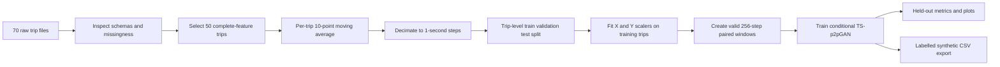

# Generation of Synthetic Multivariate Time Series Data for Electric Vehicle Driving Scenarios Using TS p2pGAN

## 1. Title page

**Student:** Name to be completed by the student  
**Program and institution:** To be completed  
**Supervisor:** To be completed  
**Date:** 11 November 2026

## 2. Abstract

This project implements a conditional time-series generative adversarial network based on Jeng's TS-p2pGAN paper. The proposed mapping conditions on ten EV, battery, heating, and environmental signals and generates four targets: state of charge, battery voltage, motor torque, and longitudinal acceleration. The supplied archive contains 70 BMW i3 trips with 1,094,793 records sampled at 100 ms. Heater voltage and heater current are absent from 20 summer trip files, so the pipeline uses 50 trips with complete required channels and records this deviation. It applies a ten-sample moving average, takes one-second-spaced samples, splits at trip level, fits feature scalers on training trips only, and rejects windows containing missing values. This produces 62,562 valid windows. The model and evaluation code are implemented, but model training and quantitative results are pending because PyTorch is unavailable in the current environment. No performance claims are made for this project.

## 3. Introduction

Electric vehicle measurements include interacting electrical, mechanical, and environmental signals. Researchers need realistic time-series data for analysis and model development, but collecting labeled measurements across many driving and temperature conditions can be difficult. Conditional GANs can learn paired mappings between observed conditions and target signals. This project adapts the TS-p2pGAN architecture described in the supplied paper to the provided BMW i3 dataset.

## 4. Problem statement

Implement a reproducible model that maps ten observed time-series channels to four corresponding output channels while retaining realistic temporal behavior. The implementation must respect trip boundaries, missing measurements, the paper's model specification, and honest reporting of deviations.

## 5. Project objectives

- Inspect the paper and every supplied trip schema.
- Map paper input and target channels to actual dataset columns.
- Build preprocessing that keeps trips independent and prevents train/test window leakage.
- Implement the 1D generator and two-scale discriminator in PyTorch.
- Train, evaluate, and export labeled synthetic sequences when a supported PyTorch environment is available.

## 6. Scope

The current implementation includes inspection, feature mapping, preprocessing, model definitions, training, evaluation, generation code, tests, and user documentation. The data-based run uses 50 complete-feature trips. Training, checkpoints, generated sequences, and project metrics remain pending.

## 7. Literature review

Jeng (2025) applies a Pix2Pix-inspired conditional GAN to EV time series. It combines an encoder-residual-decoder generator with fine- and coarse-scale discriminators, and evaluates generated signals with RMSE, MAE, DTW, PCA, and t-SNE. The paper compares TS-p2pGAN with transformer-based TTS-GAN and TimeGAN. Those published results are background evidence only and are not results from this project.

## 8. Dataset description

The archive contains 32 summer trips (TripA01–TripA32) and 38 winter trips (TripB01–TripB38). It has 1,094,793 total rows and raw sampling near 0.1 seconds. Trip lengths range from 3,545 rows to 56,102 rows. CSV schema widths range from 22 to 48 columns, so the loader checks each file rather than assuming a shared schema. The complete per-trip and per-column inventories are in `results/inspection/`.

## 9. Data collection and feature selection

The paper cites “Battery and Heating Data for Real Driving Cycles” from IEEE DataPort as its source. Figure 1(a) names the ten inputs, and Figure 1(b) names the four targets. The selected heating input is `Requested Heating Power [W]`, which the paper figure explicitly labels. The paper says “Elevation change”; because it provides no derivation, this project uses the available `Elevation [m]` channel and labels that interpretation as an assumption. Full units and availability are in `feature_mapping.json`.

## 10. Data preprocessing

The files are semicolon-delimited and use Windows-1252 encoding. The loader decodes degree symbols correctly and explicitly normalizes TripB38's malformed velocity header. A trailing ten-sample moving average is applied within each trip, then every tenth row is retained to obtain one-second steps, consistent with Figure 1's time-axis label. Each split remains at trip level. Separate X and Y MinMax scalers are fit only on the training trips and saved for later inversion. No trip concatenation or missing-value imputation occurs.

## 11. Proposed methodology



## 12. TS-p2pGAN architecture

```text
Condition X [10 x 256] -> Encoder -> 9 residual blocks -> Decoder -> Yhat [4 x 256]
Condition X + real/fake Y -> D1 at full scale
Condition X + real/fake Y -> average pool -> D2 at coarse scale
```

The discriminator probabilities from both scales contribute to adversarial training. The generator also receives L1 reconstruction feedback.

## 13. Generator design

The generator begins with reflection padding and a k7 convolution from 10 to 64 channels. Four stride-2 k3 convolutions grow channels through 128, 256, 512, and 1024 while shrinking length from 256 to 16. Nine residual blocks operate at 1024 channels. Four k3 stride-2 transposed convolutions expand back to 256 steps and reduce channels to 64. Reflection padding and a k7 output layer produce four channels, followed by Tanh. Batch normalization and ReLU follow the paper's N+R table notation.

## 14. Multiscale discriminator design

Each discriminator sees 14 concatenated channels. The fine branch uses channel widths 64, 128, 256, 512, and 1. The coarse branch first average-pools to half resolution and uses the same channel widths. LeakyReLU, selected BatchNorm layers, and sigmoid outputs follow Table 3. The documented coarse output length is 19 because the table's sigmoid row incorrectly lists 35 even though sigmoid cannot alter length.

## 15. Loss functions

The paper specifies conditional adversarial loss plus a weighted L1 loss. It does not state the numeric L1 coefficient. The config exposes `lambda_l1=100` as a configurable pix2pix-style assumption; it is not a value reported by Jeng. Training uses binary cross entropy on both discriminator scales and a generator target-real adversarial loss.

## 16. Training configuration

| Setting | Paper | Project config |
|---|---:|---:|
| Framework | PyTorch 2.1 | PyTorch (runtime not currently installed) |
| Optimizer | Adam | Adam |
| Initial learning rate | 0.0006 | 0.0006 |
| Batch size | 256 | 256 |
| Epochs | 800 | 800 |
| Decay | Final 200 epochs to zero | Final 200 epochs to zero |
| Training trips | 70 | 50 complete-feature trips |

The paper reports using an RTX 4090 with 24 GB VRAM. This workspace's available Python runtimes do not include PyTorch; package download failed because network name resolution is unavailable. No smoke or full training run has been claimed.

## 17. Experimental setup

The code creates reproducible, season-stratified trip splits with seed 42: train 35 trips, validation 8 trips, and test 7 trips. Overlapping windows from any one trip remain in only one split. Preprocessing yields 37,975 train windows, 11,779 validation windows, and 12,808 test windows. The arrays and split IDs are saved in `data/processed/`.

## 18. Evaluation metrics

The evaluation script calculates RMSE, MAE, and DTW separately for each output feature in physical units. It compares generated windows with their paired measured outputs under identical held-out conditions. This measures conditional reconstruction on unseen trips; it is not a future forecast. DTW uses a four-times-downsampled sequence and up to 100 test windows for manageable runtime.

## 19. Results and discussion

**Pending.** No training has run in this environment because PyTorch is missing. No checkpoint or project-generated evaluation metric exists. The paper's reported errors must not be represented as project findings.

## 20. Real-versus-synthetic comparisons

**Pending model training.** Once a checkpoint exists, `src.evaluate` will save paired waveform plots, target distributions, correlation matrices, PCA, and t-SNE under `results/plots/`. No synthetic output is currently presented as measured data.

## 21. Limitations

- Twenty summer files lack Heater Voltage and Heater Current, reducing the model corpus to 50 trips.
- Several winter SOC series contain long missing stretches. Affected sequences are omitted.
- The paper's elevation-change feature has no documented derivation, so raw elevation is used as an explicit interpretation.
- The paper does not state the L1 weight, dropout probability/placement, or an independent trip-level test procedure.
- The paper's generator table omits transposed-convolution output padding, and its coarse discriminator table has an inconsistent sigmoid output length.
- Training, checkpoint validation, and model quality metrics remain unverified until PyTorch is installed in a supported environment.

## 22. Conclusion

The paper-grounded data and model pipeline is implemented. It preserves the supplied measurements and discloses where the archive prevents an exact 70-trip reproduction. Preprocessing runs and produces trip-level splits and 62,562 valid windows. Model training and synthetic-data quality remain open tasks because this runtime cannot import PyTorch.

## 23. Future work

Install PyTorch in Python 3.11 or another supported environment, run model shape tests and the smoke mode, inspect checkpoint loading, then run full training if compute is sufficient. Generate held-out metrics and visuals, investigate the paper's elevation-change calculation, and obtain summer CSV versions that include heater voltage/current if reproducing the full 70-trip corpus is required.

## 24. References

1. Jeng, S.-L. “Generative Adversarial Network for Synthesizing Multivariate Time-Series Data in Electric Vehicle Driving Scenarios.” *Sensors* 2025, 25, 749.
2. IEEE DataPort. “Battery and Heating Data for Real Driving Cycles.” 2022. https://ieee-dataport.org/open-access/battery-and-heating-data-real-driving-cycles (accessed 17 November 2024, as cited by Jeng).
3. Isola, P.; Zhu, J.-Y.; Zhou, T.; Efros, A. A. “Image-to-Image Translation with Conditional Adversarial Networks.” CVPR 2017, pp. 1125–1134.
4. Wang, T.-C. et al. “High-Resolution Image Synthesis and Semantic Manipulation with Conditional GANs.” CVPR 2018, pp. 8798–8807.
5. Senin, P. “Dynamic Time Warping Algorithm Review.” University of Hawaii at Manoa, 2008.
6. van der Maaten, L.; Hinton, G. “Visualizing Data Using t-SNE.” *Journal of Machine Learning Research* 2008, 9, 2579–2605.
7. Abdi, H.; Williams, L. J. “Principal Component Analysis.” *Wiley Interdisciplinary Reviews: Computational Statistics* 2010, 2, 433–459.
8. Li, X.; Metsis, V.; Wang, H.; Ngu, A. H. H. “TTS-GAN: A Transformer-Based Time-Series Generative Adversarial Network.” 2022.
9. Juneja, T.; Bajaj, S. B.; Sethi, N. “Synthetic Time Series Data Generation Using TimeGAN with Synthetic and Real-Time Data Analysis.” 2022.

## 25. Appendix

### Project files

- `src/`: loader, inspection, preprocessing, model, loss, training, evaluation, and generation modules.
- `tests/`: data, preprocessing, and model shape tests.
- `data/processed/`: per-trip normalized arrays, scalers, split IDs, exclusions, and actual sequence counts.
- `docs/METHODOLOGY.md`: paper ambiguities and implementation assumptions.

### Architecture verification

Automated tests check generator [1,10,256] to [1,4,256], residual dimension preservation, fine/coarse discriminator shapes [2,1,35] and [2,1,19], and finite values. They are present but could not run because the environment lacks PyTorch and pytest.
